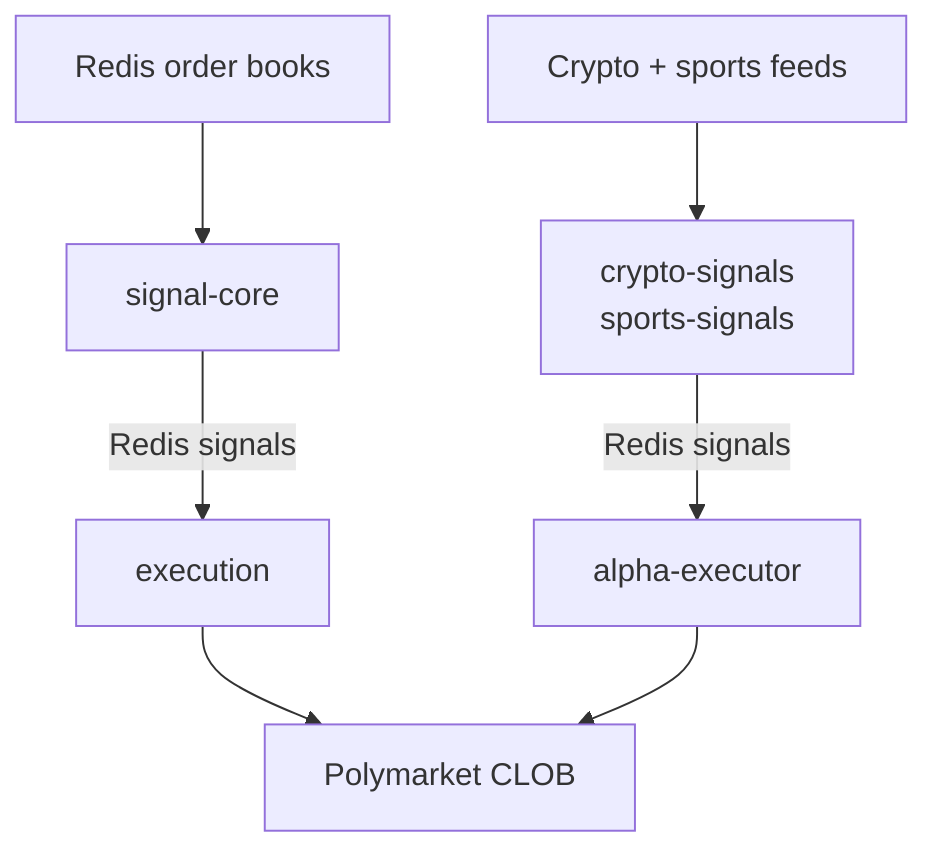
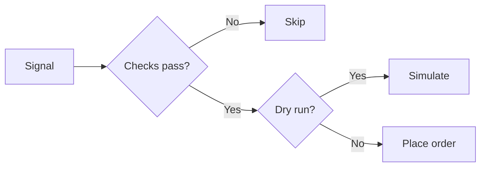

# Polymarket Research Terminal

Open-source stack for researching, simulating, monitoring, and running Polymarket strategies.


Rust ingestion, TypeScript strategy services, Redis streams, SQLite analytics, Docker Compose, and a Next.js terminal. Paper and dry-run defaults; live execution is opt-in with Redis kill switches.

No bundled accounts, wallets, or API keys. Not financial advice. Trading is off by default.

## Start here

Never used Docker:

```bash
git clone https://github.com/dantraynor/algorithmic-trading-polymarket.git
cd algorithmic-trading-polymarket
make start
```

Pick `1` (safe demo): synthetic data, no wallet, no orders.

Walkthrough: [docs/BEGINNER_GUIDE.md](docs/BEGINNER_GUIDE.md).

## Quick demo

Dashboard only, synthetic feed. No wallet, no API keys, no execution services.

```bash
git clone https://github.com/dantraynor/algorithmic-trading-polymarket.git
cd algorithmic-trading-polymarket

make doctor
make demo
```

Open [http://127.0.0.1:3001](http://127.0.0.1:3001). Sign in:

```text
demo_dashboard_secret
```

Stop:

```bash
make demo-down
```

### Demo vs full stack

| | Demo (`make demo`) | Full stack (`make up`) |
| --- | --- | --- |
| Data | Synthetic | Live market feeds |
| Services | `demo-seed`, Redis, dashboard | Ingestion, strategies, execution, settlement, dashboard |
| Orders | Cannot place orders | Paper / dry run by default; live is opt-in |
| Credentials | None | Depends on the services and trading mode |

## Services

| Area | Services |
| --- | --- |
| Market data | `ingestion`, `signal-core` |
| Crypto strategies | `btc-5m`, `btc-5m-latency`, `btc-5m-momentum`, `crypto-signals` |
| Sports strategies | `sports-signals` |
| Execution and risk | `execution`, `alpha-executor`, `settlement` |
| UI and analytics | `dashboard`, `shared` |
| Ops | Docker Compose, Terraform (GCP), Prometheus, Grafana, GitHub Actions |

Local demo and paper defaults. Strategies publish typed Redis signals; the dashboard picks them up via `apps/dashboard/src/lib/strategy-registry.ts`. CI, runbooks, and monitoring match a deployed layout.

## Architecture

### Shared signal flow

`ingestion` writes Polymarket order books to Redis. Two signal pipelines feed the shared execution services:



BTC strategy services handle their own risk checks and execution. `settlement` separately merges positions on Polygon. The dashboard reads Redis, SQLite, and optional on-chain balances.

### Order decision

Simplified decision flow. Checks include freshness, enable flags, and risk limits; the exact checks and their order vary by service.



Dry runs never submit orders. See [Safety](#safety) for the control layers.

## Full stack

For paper trading or live-ready infra.

### Prerequisites

- Docker Desktop or Docker Engine with Compose v2
- Node.js 20+ (local TS work)
- Rust stable (local Rust work)
- Polygon RPC URL for services that read chain state
- Wallet, Safe, and Polymarket CLOB credentials only if you will send orders

### Configure

```bash
make setup
```

Edit `.env`. Keep `*_DRY_RUN=true` while testing.

Derive CLOB credentials from a funded key:

```bash
cd scripts
npm install
PRIVATE_KEY=0x... node derive-keys.js
```

Put `CLOB_API_KEY`, `CLOB_API_SECRET`, and `CLOB_PASSPHRASE` in `.env`.

### Run

```bash
make up
make ps
make logs
```

Dashboard: [http://127.0.0.1:3001](http://127.0.0.1:3001)

### Enable trading

Missing switches means no trading.

```bash
# Global enable
docker exec tradingbot-redis redis-cli -s /var/run/redis/redis.sock SET TRADING_ENABLED TRUE

# Emergency stop
docker exec tradingbot-redis redis-cli -s /var/run/redis/redis.sock DEL TRADING_ENABLED
```

Each strategy has its own flag (e.g. `BTC_5M_LATENCY_TRADING_ENABLED`, `ALPHA_TRADING_ENABLED`). Global and strategy flags must both be on.

## Safety

| Layer | Behavior |
| --- | --- |
| Demo mode | No execution services, synthetic data only |
| Dry run | Logic runs, orders not sent |
| Kill switches | Global and per-strategy Redis flags |
| Risk caps | Size, slippage, drawdown, streak, exposure |
| Freshness | Stale signals and bad books dropped |
| Secrets | `.env` or Secret Manager, not the repo |

[docs/SAFETY.md](docs/SAFETY.md) for operators.

## Developer workflow

```bash
make doctor      # verify tools
make demo        # dashboard-only demo
make up          # full local stack
make test        # configured service tests
make down        # stop full stack
```

Build one service:

```bash
cd services/market-data/ingestion && cargo build --release
cd services/market-data/signal-core && cargo build --release

cd services/strategies/btc-5m-latency && npm ci && npm run build && npm test
cd apps/dashboard && npm ci && npm run build && npm test
```

## Add a strategy

1. New service dir with `src/index.ts` (or Rust equivalent).
2. Read Redis or an external feed.
3. Publish typed signals (e.g. `signals:alpha`).
4. Reuse or add a risk gate (`alpha-executor`).
5. Wire into Docker Compose.
6. Register in `apps/dashboard/src/lib/strategy-registry.ts`.
7. Tests for signals and risk.

[CONTRIBUTING.md](CONTRIBUTING.md).

## Docs

- [Beginner guide](docs/BEGINNER_GUIDE.md)
- [Demo mode](docs/DEMO_MODE.md)
- [Configuration](docs/CONFIGURATION.md)
- [Safety](docs/SAFETY.md)
- [Deploy runbook](docs/DEPLOY_RUNBOOK.md)
- [Wallet setup](docs/WALLET_SETUP.md)
- [Roadmap](docs/ROADMAP.md)

## Layout

| Role | Location |
| --- | --- |
| Terminal UI | `apps/dashboard/` |
| Shared TypeScript library | `packages/shared/` |
| Market data (Rust) | `services/market-data/ingestion/`, `services/market-data/signal-core/` |
| Strategy services | `services/strategies/` (`btc-5m*`, `crypto-signals`, `sports-signals`) |
| Execution and settlement | `services/trading/` (`execution`, `alpha-executor`, `settlement`) |
| Infrastructure and tooling | `infrastructure/`, `scripts/` |
| Guides and runbooks | `docs/` |

Root-level Docker Compose files and the Makefile orchestrate the tree above; Compose service names (for example `ingestion`, `dashboard`) are unchanged.

Prediction markets and automation carry financial, legal, and ops risk. Use where allowed; start demo or paper; review strategies; do not commit secrets.

## License

[MIT](LICENSE)
